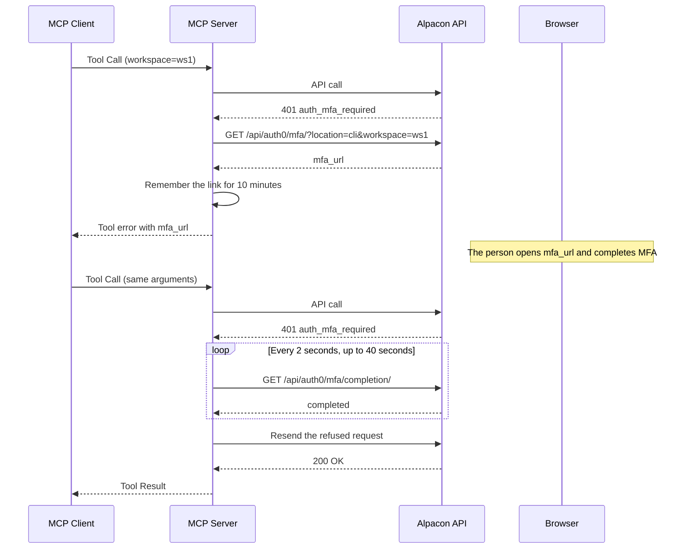

# MFA flows for the MCP server

This document describes how the MCP server answers the two MFA refusals the Alpacon API can send: a step-up link for action MFA, and a 403 with a two-stage OAuth flow for sign-in MFA.

## Overview

The Alpacon API answers 401 with one of two codes:

- `auth_mfa_required` (action MFA): one action needs a fresh MFA. A JWT caller gets a tool error carrying `mfa_url`, a step-up link, in every mode (stdio, SSE, and streamable-http). The person completes MFA in a browser and calls the tool again; no re-authorization happens.
- `auth_token_mfa_missing` (sign-in MFA): the token was issued without the sign-in MFA the workspace requires, and a refresh never adds it. In remote mode (`ALPACON_MCP_AUTH_ENABLED=true`, a JWT caller) this starts the two-stage OAuth flow. A step-up link cannot help, because the endpoint that issues it uses the same authentication.

A static API token cannot do MFA, so it gets the plain error and no link.

The sign-in MFA challenge is a 403 `insufficient_scope`, not a 401. MCP clients answer a 401 by refreshing the token first and drop the challenge's scope while the refresh succeeds, so a 401 never reaches `/oauth/authorize` and the refreshed token still lacks MFA. On `insufficient_scope` the TypeScript SDK and Claude's clients skip the refresh and authorize with the union of the granted and challenged scopes. The challenge's `WWW-Authenticate` header and body carry an `error_description` asking the person to reconnect the server.

## Flow diagrams

### Action MFA: step-up link

If the MFA is not complete after 40 seconds, or the resent request is refused again, the server returns the remembered link again instead of minting a new one; a refused resend does not extend the link's ten minutes. A reply that says MFA is complete is accepted even if it arrives just after the 40 seconds. The resend is tried once, without retries, so the wait and the resend together stay under the 60-second request timeout MCP clients default to. The link is in the error's `message` as well as in `mfa_url`. If the link endpoint answers that MFA is already done, the error asks the person to call again. A second refusal within the same tool call (for example the two stages of `get_server_metrics_summary`, or a sequential `execute_command_multi_server`) returns the link that call just minted at once: it neither waits nor resends, because the person has not seen the link yet. A refusal in a later tool call waits and resends as above. The error's recovery hints tell the agent to open the link and call the tool again; they never suggest re-running setup. If the link cannot be had at all (a failed request, a token without a client instance, or no workspace bound to the call), the server falls back to the 403 challenge in remote mode and to a plain MFA error in stdio mode.

The link is remembered per person, client instance and origin (the token's `sub` and `client_instance` claim, and the scheme and host of the refused request), so a link for one workspace is never reused for another; a token without a client instance gets no link at all: the server issues no step-up ticket for it, so MFA done through a link would be credited to the browser and could not unlock the action.

### Sign-in MFA: two-stage OAuth

## Device id per grant

The Auth0 action stores MFA presence under a key named by the `device:<id>` scope and restores the claim from it on refresh. Remote MCP refreshes server-side and stores nothing, so the id has to come back with every refresh: `/oauth/authorize` mints one per grant and parks it in the signed state, `/oauth/callback` seals the code with it, and `/oauth/token` seals every refresh token it returns under the same id and forwards it as `device_id` on every refresh. The client only echoes back what it received.

One id per grant means one MFA record per MCP client installation: a step-up in one client does not refresh another's presence, and a password-only login in one does not clear the record another refreshes against. The sealed value's shape and key are described in [configuration.md](configuration.md).

## Key components

| Component | File | Role |
|-----------|------|------|
| Upstream 401 detection | `utils/http_client.py` | Raises `ActionMfaRequired` for `auth_mfa_required` and hands it to `StepUp`; signals MFA re-auth on `auth_token_mfa_missing` |
| Step-up links | `utils/step_up.py` | `StepUp` issues the link, waits for the MFA, and decides the resend; remembers the link per person, client instance and origin for ten minutes |
| Request workspace | `utils/request_workspace.py` | Carries the call's workspace to the HTTP layer for the link request |
| Auth error middleware | `utils/auth_error_middleware.py` | Answers an MFA signal with 403 `insufficient_scope` and `mfa` in the scope, adding the reconnect `error_description` for sign-in MFA |
| OAuth proxy (authorize) | `utils/oauth.py` | Routes to MFA or regular audience based on scope |
| OAuth proxy (callback) | `utils/oauth.py` | Handles two-stage callback (MFA → regular) |

## Configuration

| Environment variable | Description | Example |
|---------------------|-------------|---------|
| `ALPACON_ACCOUNT_URL` | Account service base URL (renamed-slug resolution) | `https://account.alpacax.com` |
| `AUTH0_MFA_AUDIENCE` | Auth0 MFA API audience | `https://{domain}/mfa/` |
| `AUTH0_NAMESPACE` | JWT custom claim namespace | `https://alpacon.io/` |
| `ALPACON_MCP_GRANT_SECRET` | Key that seals codes and refresh tokens (optional; derived from the client secret otherwise) | `openssl rand -hex 32` |
