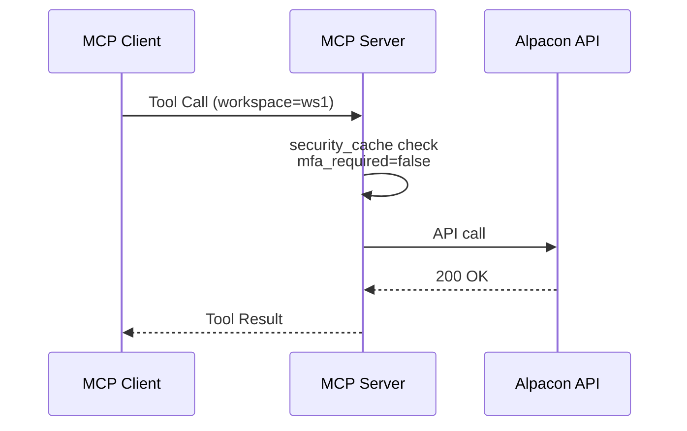
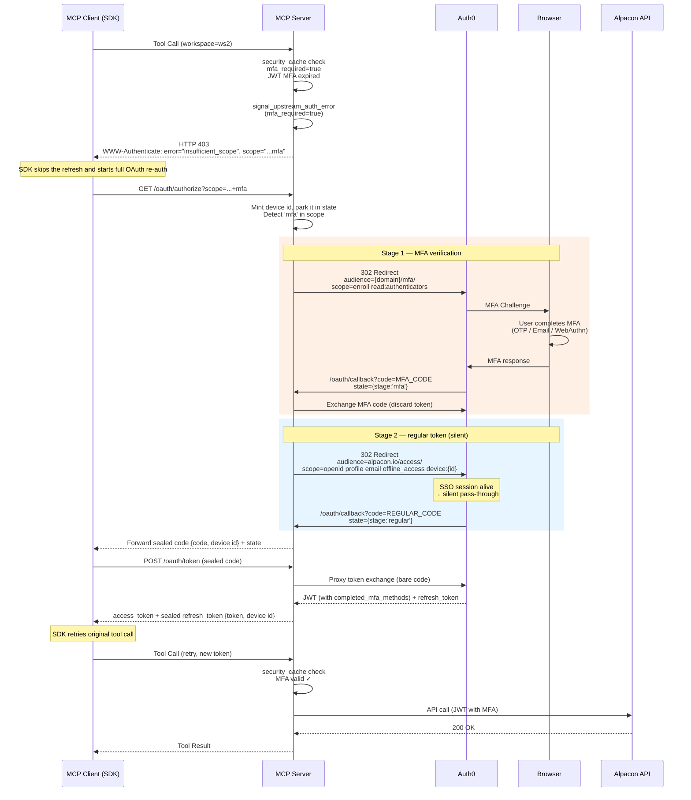
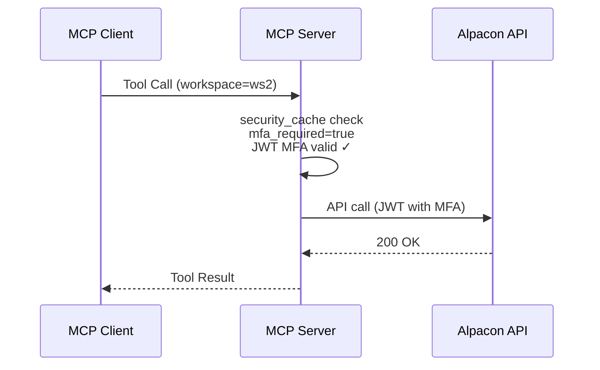

# MFA re-authentication flow for MCP server

This document describes how the MCP server handles workspace-level MFA requirements using a two-stage OAuth flow.

## Overview

Some Alpacon workspaces require MFA for sensitive actions (websh, webftp, command). The MCP server proactively detects this by caching workspace security settings from the account service, and triggers a two-stage OAuth flow when MFA is needed.

In remote mode (`ALPACON_MCP_AUTH_ENABLED=true`, a JWT caller), the flow also starts when the Alpacon API answers 401 with `auth_mfa_required` (an action asked for a fresh MFA) or `auth_token_mfa_missing` (the token lacks the workspace's sign-in MFA, which a refresh never adds).

The challenge is a 403 `insufficient_scope`, not a 401. MCP clients answer a 401 by refreshing the token first and drop the challenge's scope while the refresh succeeds, so a 401 never reaches `/oauth/authorize` and the refreshed token still lacks MFA. On `insufficient_scope` the TypeScript SDK and Claude's clients skip the refresh and authorize with the union of the granted and challenged scopes.

## Flow diagrams

### Case 1: MFA not required

### Case 2: MFA required, not yet completed

### Case 3: MFA required, already completed (cache hit)

## Device id per grant

The Auth0 action stores MFA presence under a key named by the `device:<id>` scope and restores the claim from it on refresh. Remote MCP refreshes server-side and stores nothing, so the id has to come back with every refresh: `/oauth/authorize` mints one per grant and parks it in the signed state, `/oauth/callback` seals the code with it, and `/oauth/token` seals every refresh token it returns under the same id and forwards it as `device_id` on every refresh. The client only echoes back what it received.

One id per grant means one MFA record per MCP client installation: a step-up in one client does not refresh another's presence, and a password-only login in one does not clear the record another refreshes against. The sealed value's shape and key are described in [configuration.md](configuration.md).

## Key components

| Component | File | Role |
|-----------|------|------|
| Security settings cache | `utils/security_settings.py` | Caches workspace MFA settings from account service |
| MFA pre-check | `utils/decorators.py` | Checks MFA before API call, signals MFA re-auth if needed |
| Upstream 401 detection | `utils/http_client.py` | Signals MFA re-auth when the API answers `auth_mfa_required` or `auth_token_mfa_missing` |
| Auth error middleware | `utils/auth_error_middleware.py` | Answers an MFA signal with 403 `insufficient_scope` and `mfa` in the scope |
| OAuth proxy (authorize) | `utils/oauth.py` | Routes to MFA or regular audience based on scope |
| OAuth proxy (callback) | `utils/oauth.py` | Handles two-stage callback (MFA → regular) |

## Ledger stage

The command pre-approval ledger tools reuse the same step-up in remote mode (`ALPACON_MCP_REMOTE_LEDGER=true`). A ledger tool with no usable ledger token signals `ledger_org`, the middleware answers 403 `insufficient_scope` with `ledger:<workspace>` in the scope, and `/oauth/authorize` turns that pseudo-scope into one more leg: an authorization-code sign-in for the ledger audience, run after the MFA leg (if any) and before the regular one. Its code is exchanged server to server like the MFA leg's, but the token is kept: an encrypted cookie carries it to the regular callback, the sealed code carries it to `/oauth/token`, and the access token handed to the client carries it from then on. See `docs/configuration.md` for the details and the Auth0 settings.

## Configuration

| Environment variable | Description | Example |
|---------------------|-------------|---------|
| `ALPACON_ACCOUNT_URL` | Account service base URL | `https://account.alpacax.com` |
| `AUTH0_MFA_AUDIENCE` | Auth0 MFA API audience | `https://{domain}/mfa/` |
| `AUTH0_NAMESPACE` | JWT custom claim namespace | `https://alpacon.io/` |
| `ALPACON_MCP_GRANT_SECRET` | Key that seals codes and refresh tokens (optional; derived from the client secret otherwise) | `openssl rand -hex 32` |
