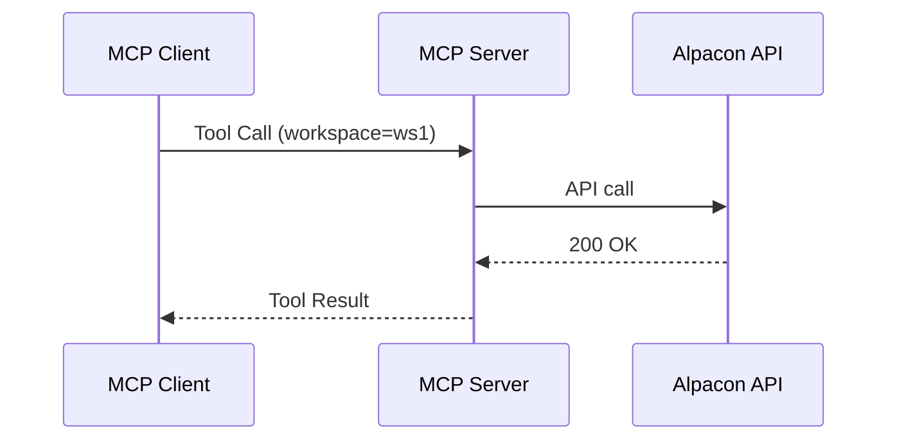
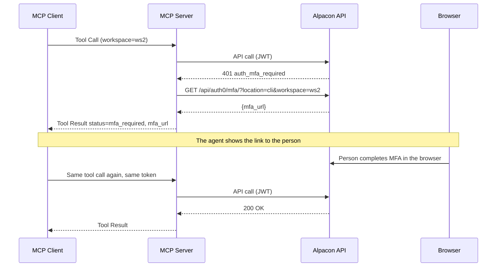
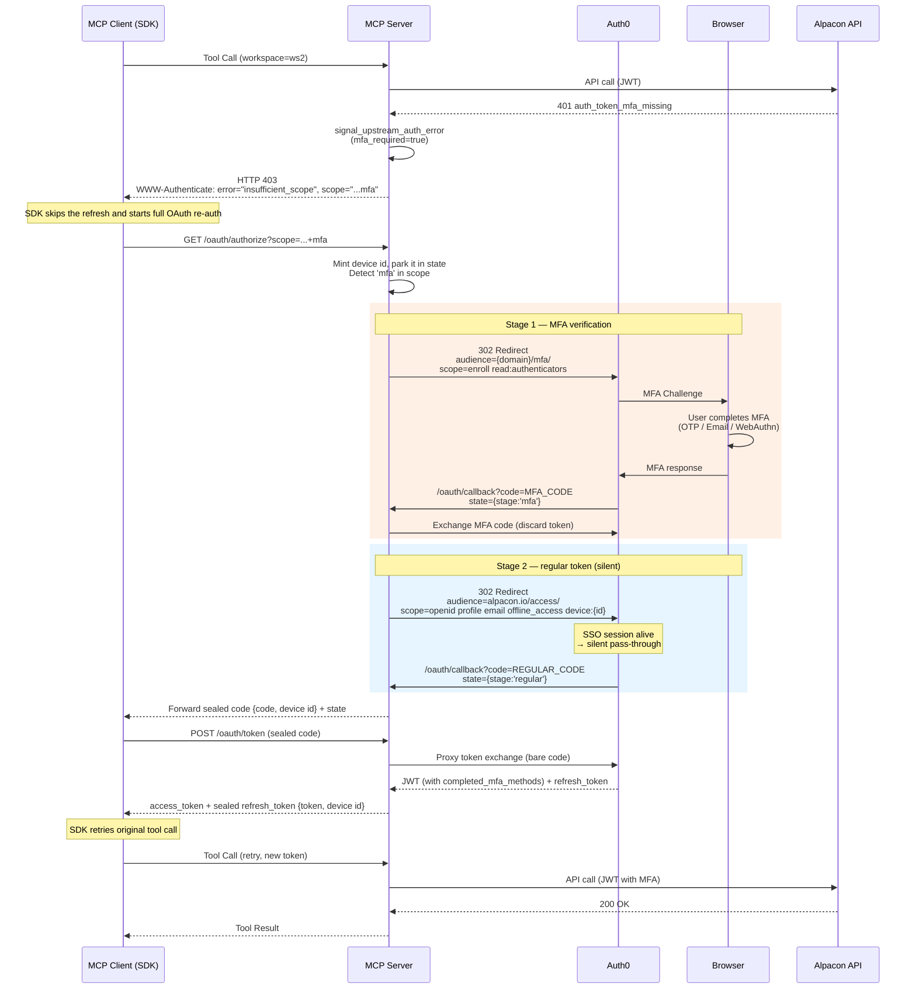

# MFA re-authentication flow for MCP server

This document describes how the MCP server answers Alpacon's MFA refusals: a step-up link in the tool result, or a re-login through a two-stage OAuth flow.

## Overview

Some Alpacon workspaces require MFA for sensitive actions (`websh`, `webftp`, `command`). The MCP server does not decide that itself: it calls Alpacon, and Alpacon's own gate refuses before the view runs. What happens next depends on the 401 code, in remote mode (`ALPACON_MCP_AUTH_ENABLED=true`, a JWT caller):

- `auth_mfa_required` (an action asked for a fresh MFA): the tool call returns `status="mfa_required"` with Alpacon's MFA link. The same token passes on a retry, because Alpacon credits the browser step-up to the token's client instance.
- `auth_token_mfa_missing` (the token lacks the workspace's sign-in MFA, which a refresh never adds): the request answers 403 `insufficient_scope` and the client re-authenticates through the two-stage OAuth flow below.

The re-login challenge is a 403, not a 401. MCP clients answer a 401 by refreshing the token first and drop the challenge's scope while the refresh succeeds, so a 401 never reaches `/oauth/authorize` and the refreshed token still lacks MFA. On `insufficient_scope` the TypeScript SDK and Claude's clients skip the refresh and authorize with the union of the granted and challenged scopes.

## Flow diagrams

### Case 1: MFA not required

### Case 2: `auth_mfa_required`, link in the tool result

The link fetch answers an object whose only key is `detail` (Alpacon sends `{"detail": "MFA is already done."}`, read by shape so a translated text still counts) when it already holds a fresh MFA for the token; the result then carries `mfa_url: null` and the same retry instruction. Any other answer, or a failed fetch, also gives `mfa_url: null` and tells a person to complete MFA in the Alpacon web console. Any other 401 on the link fetch ends the call like an upstream 401 elsewhere: the 401 `invalid_token` challenge, or Case 3's 403 when the code is `auth_token_mfa_missing`; an `auth_mfa_required` there counts as a failed fetch.

A tool that fans out to several calls and swallows a refusal still answers `mfa_required`: the step-up is recorded in a per-call holder (`utils/mfa_step_up.py`) at the moment the 401 arrives, and the outermost `with_error_handling` reads it. When a tool that is not read-only caught the refusal and returned normally, the result adds `partial_result`, the tool's own result as returned (it may hold no successful part), and asks for a retry of the refused parts only, never the whole call; a read-only tool always asks for the whole call to be retried and carries no `partial_result`. Once a step-up is recorded, every further request in that tool call, a retry after backoff included, raises before it is sent, so a refusal is not followed by more side effects. For `execute_file` with `write_file=true`, the message replaces the whole-call retry with: the file may already be on the host, so retry with `read_from_server=true` and without `write_file` and `content`.

### Case 3: `auth_token_mfa_missing`, re-login

## Device id per grant

The Auth0 action stores MFA presence under a key named by the `device:<id>` scope and restores the claim from it on refresh. Remote MCP refreshes server-side and stores nothing, so the id has to come back with every refresh: `/oauth/authorize` mints one per grant and parks it in the signed state, `/oauth/callback` seals the code with it, and `/oauth/token` seals every refresh token it returns under the same id and forwards it as `device_id` on every refresh. The client only echoes back what it received.

One id per grant means one MFA record per MCP client installation: a step-up in one client does not refresh another's presence, and a password-only login in one does not clear the record another refreshes against. The sealed value's shape and key are described in [configuration.md](configuration.md).

## Key components

| Component | File | Role |
|-----------|------|------|
| Upstream 401 detection | `utils/http_client.py` | Records a step-up on `auth_mfa_required`; signals MFA re-auth on `auth_token_mfa_missing` |
| MFA step-up | `utils/mfa_step_up.py` | Per-call holder, `MfaStepUpRequired`, the link fetch and the `mfa_required` result |
| Result assembly | `utils/decorators.py` | The outermost `with_error_handling` calls `step_up_result` |
| Auth error middleware | `utils/auth_error_middleware.py` | Answers an MFA signal with 403 `insufficient_scope` and `mfa` in the scope |
| OAuth proxy (authorize) | `utils/oauth.py` | Routes to MFA or regular audience based on scope |
| OAuth proxy (callback) | `utils/oauth.py` | Handles two-stage callback (MFA → regular) |

## Ledger stage

The command pre-approval ledger tools reuse the same step-up in remote mode (`ALPACON_MCP_REMOTE_LEDGER=true`). A ledger tool with no usable ledger token signals `ledger_org`, the middleware answers 403 `insufficient_scope` with `ledger:<workspace>` in the scope, and `/oauth/authorize` turns that pseudo-scope into one more leg: an authorization-code sign-in for the ledger audience, run after the MFA leg (if any) and before the regular one. Its code is exchanged server to server like the MFA leg's, but the token is kept: an encrypted cookie carries it to the regular callback, the sealed code carries it to `/oauth/token`, and the access token handed to the client carries it from then on. See `docs/configuration.md` for the details and the Auth0 settings.

## Configuration

The legacy Auth0 environment variable names still work as fallbacks and will be removed in a later release; see [environment configuration](configuration.md#environment-configuration).

| Environment variable | Description | Example |
|---------------------|-------------|---------|
| `AUTH0_ALPACON_MFA_AUDIENCE` | Auth0 MFA API audience | `https://{domain}/mfa/` |
| `AUTH0_ALPACON_NAMESPACE` | JWT custom claim namespace | `https://alpacon.io/` |
| `ALPACON_MCP_GRANT_SECRET` | Key that seals codes and refresh tokens (optional; derived from the client secret otherwise) | `openssl rand -hex 32` |
